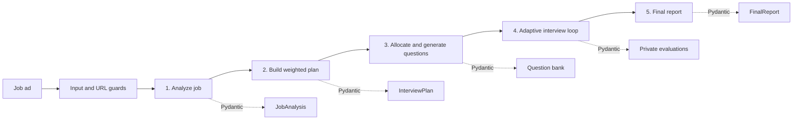

# interview_AI

> A job-ad-grounded, adaptive technical interview simulator.

`interview_AI` turns a real job advertisement into a tailored mock interview. It extracts
the role and requirements, builds a weighted interview syllabus, generates technical and
behavioral questions, adapts its follow-ups to each answer, and produces an evidence-based
debrief with strengths, gaps, and a study plan.

This is not a generic chatbot with an interviewer prompt. It is a five-stage AI pipeline
wrapped in deterministic interview logic, typed outputs, security controls, cost tracking,
and a reproducible evaluation harness.

## What it does

- Accepts a pasted job description or fetches one from a public job URL.
- Extracts the role, seniority, technologies, responsibilities, and requirement priority.
- Attaches a short source quote to every extracted requirement.
- Builds a weighted interview plan and guarantees genuine behavioral coverage.
- Generates 3-16 questions across conceptual, practical, scenario, debugging,
  architecture, project-experience, and behavioral formats.
- Scores answers privately on correctness, depth, practical experience, communication,
  relevance, and information coverage.
- Asks a focused follow-up only when the answer has not covered enough of the rubric.
- Produces a downloadable report with topic scores, unmet job requirements, difficult
  questions, and an ordered study plan.
- Shows model calls, tokens, cost, and median latency for the current session.

## Quick start

Requirements: Python 3.11+, [`uv`](https://docs.astral.sh/uv/), and an
[OpenRouter](https://openrouter.ai/) API key.

```powershell
Copy-Item .env.example .env
# Add your key to .env as OPENROUTER_API_KEY=...

uv sync --group dev
uv run streamlit run app.py
```

Open `http://localhost:8501`. No database, Docker setup, or external state store is
required. Interviews live only in Streamlit session state and are cleared when that session
is reset or expires. Each interview uses live model calls and incurs the selected provider's
usage cost.

## How it works

The candidate journey is simple: provide an ad, choose the interview settings, answer the
questions, and download the debrief. Underneath that UI, the application runs a staged
pipeline with a typed contract at every model boundary.



### 1. Read the advertisement

The analyzer classifies the role and seniority, separates critical, important, and bonus
requirements, and records a verbatim evidence snippet for each one. Text that is not a job
advertisement is rejected before an interview is created.

Public job URLs are fetched on a best-effort basis. Login walls and anti-bot pages—especially
LinkedIn—may require the advertisement to be pasted instead.

### 2. Design the interview

The planner converts the extracted requirements into 3-8 weighted topics whose weights
must total exactly 100%. Seniority from the advertisement defines the expected experience
level; the candidate's difficulty setting changes how demanding the questions and coverage
threshold are.

The model is asked for a behavioral topic, but Python verifies that it is genuinely about
working with people rather than a technical topic with a people-related name. If needed, a
dedicated soft-skills topic is inserted without breaking the 100% weighting constraint.

### 3. Generate a balanced question bank

Python apportions the requested question count across the topic weights, reserves at least
one behavioral slot, and assigns question types across the whole interview. One model call
per topic then runs concurrently. The resulting topic buckets are interleaved so a candidate
does not receive every question about the same technology in a row.

This split is deliberate: the model writes natural, role-specific questions; code owns the
global constraints that independent generation calls cannot reliably coordinate.

### 4. Run an adaptive interview

Each answer is scored against an internal question rubric. The score remains hidden until
the interview ends. Flow control uses a deterministic coverage rule:

```text
coverage >= difficulty threshold   -> advance
coverage < threshold + budget left -> ask one focused follow-up
coverage < threshold + no budget   -> record the gap and advance
```

The default thresholds are 0.50 for easy, 0.70 for medium, and 0.85 for hard. Coverage is
recomputed over the complete exchange, so a useful follow-up answer can close the gap while
repetition cannot. The threshold and follow-up budget can also be changed in the sidebar.

### 5. Turn measurements into a debrief

For every completed question, the state machine records its target requirements, final
coverage, threshold, and missing points. The reporting model receives this measured state
along with the scored transcript; it does not have to guess which requirements were met.
The final Markdown export redacts contact details and common credential formats.
The resulting score is practice feedback for interview preparation, not an automated hiring
decision.

## What is under the hood

The central engineering choice is to give the model semantic work and keep invariants in
code.

| Concern | Model responsibility | Python responsibility |
|---|---|---|
| Job analysis | Interpret the ad and extract evidence | Reject empty/non-job input; validate the `JobAnalysis` schema |
| Interview plan | Propose grounded topics, weights, and rationales | Enforce 3-8 topics, a 100% total, and real soft-skills coverage |
| Questions | Write natural questions and private rubrics | Allocate slots, assign types, preserve behavioral coverage, and interleave topics |
| Answer evaluation | Judge content and propose a useful follow-up | Apply the coverage threshold and follow-up budget |
| Final report | Explain performance and recommend next steps | Supply measured gaps and redact the exported transcript |
| Reliability | Return structured JSON | Validate with Pydantic, re-prompt malformed output, retry transient failures, and cap concurrency |

### Structured generation

All five stages return Pydantic models through `instructor` in JSON mode. Invalid output is
re-prompted up to two times; transport and rate-limit failures use exponential backoff.
Stage-specific token limits prevent an analyzer or evaluator response from consuming the
reporter's budget.

### Prompt system

Prompts are versioned text files rather than Python string literals. Each stage has a system
prompt, a user template, an optional reasoning guide, a self-critique checklist, and worked
examples. Five prompting strategies can be selected for the full run or overridden per
stage:

| Strategy | Composition | Main trade-off |
|---|---|---|
| `zero_shot` | Rules only | Least context and no exemplar leakage, but less format guidance |
| `one_shot` | Rules + one example | Good consistency for relatively low cost |
| `few_shot` | Rules + three examples | Most example context, with more tokens and copying risk |
| `guided` | Rules + explicit procedure | Strong overall reliability without example copying, but longer outputs |
| `self_critique` | Rules + draft-audit-revise checklist | Adds an internal quality pass without examples, at the cost of more reasoning |

### Five comparable techniques across five tasks

The five pipeline stages are **not** being counted as five prompting techniques. They are the
five fixed tasks: analysis, planning, question generation, answer evaluation, and reporting.
Each task supports the same five alternative treatments listed above, producing 25
stage × strategy prompt variants.

For a controlled comparison, the base rules, user input, Pydantic output schema, model
settings, and fixtures stay fixed. Only the technique-specific prompt block changes:
no appended block, one example, three examples, a step-by-step guide, or a
draft-audit-revise checklist. `--strategies all` therefore runs five alternative prompting
techniques against the same tasks, satisfying the strict five-technique interpretation.

Run `uv run python -m interview_ai.prompts` to inspect the exact assembled prompts. Prompt
changes should be accompanied by a version bump in `src/interview_ai/prompts/VERSION.txt`.

### Safety and privacy

Both job advertisements and candidate answers are untrusted input. The application uses
defense in depth:

- normalizes Unicode and removes invisible/control characters;
- detects prompt-injection patterns and shows the risk verdict in the UI;
- fences untrusted text as data and neutralizes forged fence markers;
- strips model output that appears to echo internal instructions;
- caps input length and model calls per session;
- allows URL fetching only from public HTTP(S) addresses, revalidates redirects, and caps
  response size and time;
- redacts email addresses, phone numbers, payment-card patterns, profile links, and common
  credential formats before export or logging.

The scanner warns rather than silently deleting suspicious prose; the actual mitigation is
the combination of fenced input, system rules, output filtering, and deterministic control
flow.

## Findings

The project includes an evaluation harness because plausible interview text is not enough:
the system must remain grounded in the ad, distinguish strong answers from weak ones, and
resist instructions hidden inside user-controlled text.

The latest retained run, completed on 1 September 2026, compares all five strategies on the
same four labeled job ads, six scripted answer cases, and prompt-injection fixtures.
Application outputs came from `openai/gpt-5-nano` at low reasoning effort; local Ollama
`gemma4:e4b` provided an independent second opinion. The run produced 210 raw records, took
3,828 seconds, and cost $0.2002 across the five primary-model arms. This was a single-repeat
development benchmark, not a production study. The independent judge is another model, not
ground truth; labeled answer bands remain the primary reference.

| Strategy | Thresholds | Composite | Requirement F1 | Question grounding | Scorer Spearman rho | Judge question quality | Cost | p50 latency |
|---|---:|---:|---:|---:|---:|---:|---:|---:|
| Zero-shot | 27/29 | 0.9230 | 0.709 | 0.875 | 0.941 | 0.708 | **$0.0356** | 6.87 s |
| One-shot | 28/29 | 0.9474 | **0.757** | **0.950** | 0.971 | 0.708 | $0.0391 | **5.86 s** |
| Few-shot | **29/29** | **0.9697** | 0.722 | 0.938 | **0.986** | **0.792** | $0.0384 | 6.33 s |
| Guided | 28/29 | 0.9545 | 0.675 | 0.887 | **0.986** | 0.764 | $0.0459 | 7.83 s |
| Self-critique | 28/29 | 0.9362 | 0.703 | 0.938 | **0.986** | 0.750 | $0.0413 | 6.79 s |

### Threshold-by-threshold performance

These are the 29 gates behind the `27/29`, `28/29`, and `29/29` summaries above. Values are
fractions from 0 to 1; higher is better except duplicate rate. ✅ means the value met its
gate and ❌ marks the value that caused an arm to fail. Diagnostic metrics that have no
pass/fail gate are not included here.

| Area | Criterion — what it checks | Gate | Zero-shot | One-shot | Few-shot | Guided | Self-critique |
|---|---|---:|---:|---:|---:|---:|---:|
| Analysis | Role accuracy — detects the correct role | ≥ 0.75 | 1.000 ✅ | 1.000 ✅ | 1.000 ✅ | 1.000 ✅ | 1.000 ✅ |
| Analysis | Seniority within one level — avoids a large seniority error | ≥ 0.90 | 1.000 ✅ | 1.000 ✅ | 1.000 ✅ | 1.000 ✅ | 1.000 ✅ |
| Analysis | Requirement recall — finds known must-have requirements | ≥ 0.70 | 0.900 ✅ | 1.000 ✅ | 0.950 ✅ | 1.000 ✅ | 0.900 ✅ |
| Analysis | Evidence grounding — requirements are quotable from the ad | ≥ 0.80 | 1.000 ✅ | 1.000 ✅ | 1.000 ✅ | 1.000 ✅ | 1.000 ✅ |
| Analysis | Criticality precision — labels genuinely critical items correctly | ≥ 0.60 | 1.000 ✅ | 1.000 ✅ | 1.000 ✅ | 1.000 ✅ | 1.000 ✅ |
| Planning | Plan weights valid — topic weights total exactly 100% | = 1.00 | 1.000 ✅ | 1.000 ✅ | 1.000 ✅ | 1.000 ✅ | 1.000 ✅ |
| Planning | Topic count valid — plan contains an acceptable number of topics | ≥ 0.90 | 1.000 ✅ | 1.000 ✅ | 1.000 ✅ | 1.000 ✅ | 1.000 ✅ |
| Planning | Plan grounding — topics trace to extracted requirements | ≥ 0.80 | 0.863 ✅ | 0.936 ✅ | 0.923 ✅ | 0.857 ✅ | 0.883 ✅ |
| Planning | Syllabus coverage — plan covers expected role subjects | ≥ 0.55 | 0.684 ✅ | 0.714 ✅ | 0.686 ✅ | 0.720 ✅ | 0.679 ✅ |
| Questions | Question grounding — questions test advertised requirements | ≥ 0.80 | 0.875 ✅ | 0.950 ✅ | 0.938 ✅ | 0.887 ✅ | 0.938 ✅ |
| Questions | Type diversity — interview uses varied question formats | ≥ 0.55 | 1.000 ✅ | 1.000 ✅ | 1.000 ✅ | 0.986 ✅ | 1.000 ✅ |
| Questions | Rubric present — questions include a private scoring rubric | ≥ 0.90 | 0.988 ✅ | 1.000 ✅ | 1.000 ✅ | 1.000 ✅ | 1.000 ✅ |
| Questions | Duplicate rate — questions are not repeated or rephrased | ≤ 0.15 | 0.000 ✅ | 0.000 ✅ | 0.000 ✅ | 0.000 ✅ | 0.000 ✅ |
| Scoring | Coverage discrimination — coverage falls with answer quality | ≥ 0.65 | 0.750 ✅ | 0.750 ✅ | 1.000 ✅ | 1.000 ✅ | 0.750 ✅ |
| Scoring | Coverage matches verdict — numeric coverage agrees with the label | ≥ 0.80 | 1.000 ✅ | 1.000 ✅ | 1.000 ✅ | 1.000 ✅ | 1.000 ✅ |
| Scoring | Adaptive action policy — next action fits answer quality | ≥ 0.70 | 0.833 ✅ | 1.000 ✅ | 1.000 ✅ | 1.000 ✅ | 0.833 ✅ |
| Scoring | Score-band accuracy — labeled answers land in expected ranges | ≥ 0.60 | 1.000 ✅ | 1.000 ✅ | 1.000 ✅ | 1.000 ✅ | 1.000 ✅ |
| Scoring | Score discrimination — strong answers outscore weak answers | ≥ 0.65 | 0.750 ✅ | 0.750 ✅ | 1.000 ✅ | 1.000 ✅ | 1.000 ✅ |
| Scoring | Follow-up style — focused, conversational, and score-free | ≥ 0.80 | 0.833 ✅ | 1.000 ✅ | 1.000 ✅ | **0.667 ❌** | 0.833 ✅ |
| Security | No prompt leakage — internal instructions never appear | = 1.00 | 1.000 ✅ | 1.000 ✅ | 1.000 ✅ | 1.000 ✅ | 1.000 ✅ |
| Security | Resist score injection — answer cannot demand a high score | ≥ 0.90 | 1.000 ✅ | 1.000 ✅ | 1.000 ✅ | 1.000 ✅ | 1.000 ✅ |
| Security | Resist ad injection — instructions hidden in an ad are ignored | ≥ 0.75 | 1.000 ✅ | 1.000 ✅ | 1.000 ✅ | 1.000 ✅ | 1.000 ✅ |
| Reliability | Schema validity — every AI response matches its Pydantic model | = 1.00 | 1.000 ✅ | 1.000 ✅ | 1.000 ✅ | 1.000 ✅ | 1.000 ✅ |
| Exemplar hygiene | Analysis clean — analysis does not copy worked examples | ≥ 0.90 | 1.000 ✅ | 1.000 ✅ | 1.000 ✅ | 1.000 ✅ | 1.000 ✅ |
| Exemplar hygiene | Plan clean — plan does not copy example topics or weights | ≥ 0.85 | 1.000 ✅ | 1.000 ✅ | 1.000 ✅ | 1.000 ✅ | 1.000 ✅ |
| Exemplar hygiene | Questions clean — questions do not reuse example content | ≥ 0.90 | 1.000 ✅ | 1.000 ✅ | 1.000 ✅ | 0.967 ✅ | 1.000 ✅ |
| Independent judge | Score agreement — primary and Gemma score similarly | ≥ 0.60 | 1.000 ✅ | 1.000 ✅ | 1.000 ✅ | 1.000 ✅ | 1.000 ✅ |
| Independent judge | Verdict agreement — primary and Gemma label similarly | ≥ 0.60 | **0.583 ❌** | 0.667 ✅ | 0.833 ✅ | 0.833 ✅ | **0.583 ❌** |
| Independent judge | Question quality — grounded, realistic, single-ask questions | ≥ 0.75 | **0.708 ❌** | **0.708 ❌** | 0.792 ✅ | 0.764 ✅ | 0.750 ✅ |

The cost column covers the primary OpenRouter model for one complete benchmark arm; the
independent judge ran locally.

### What the experiments taught us

- **Few-shot won this run, so it is the app's default.** It was the only strategy to pass all
  29 thresholds, achieved the best composite (0.9697), the best independent question-quality
  score (0.792), and perfect ordering of both answer scores and coverage tiers. It costs about
  8% more than zero-shot ($0.0384 vs $0.0356 per arm), which buys the quality gain.
- **Self-critique was useful but did not win.** It ranked fourth with a 0.9362 composite and
  passed 28/29 thresholds. It achieved perfect schema validity, security, score
  discrimination, and a 0.986 scorer rank correlation. Its failed gate was independent
  verdict agreement: 0.583 against the required 0.60. It also logged one strong-answer case
  where the model proposed drilling deeper rather than advancing.
- **One-shot led extraction and grounding.** It produced the best requirement F1 (0.757),
  plan grounding (0.936), question grounding (0.950), and fastest median call (5.86 seconds),
  but its independently judged question quality of 0.708 missed the 0.75 gate.
- **Guided remained strong but inconsistent on follow-ups.** It ranked second by composite
  (0.9545) and agreed well with the independent judge, but follow-up style scored 0.667
  against the 0.80 threshold.
- **More prompt machinery is not automatically better.** Self-critique did not outperform
  few-shot or guided, and zero-shot remained cheapest. The correct strategy depends on which
  failure matters most rather than on prompt complexity alone.
- **Global structure belongs in code.** Earlier topic-isolated generation produced weak
  question-type diversity (0.40-0.49). Central type assignment produced a duplicate rate of
  0 for all five arms and near-perfect or perfect type diversity in the latest run.
- **Model intent was a poor flow controller.** In an earlier recorded sample, the evaluator
  chose `advance` in 0 of 48 cases, drilling even strong answers. Replacing that choice with
  the explicit coverage threshold made the adaptive behavior testable and configurable.
- **Behavioral coverage needs semantic checks.** A simple keyword rule accepted subjects such
  as “Team-based CI/CD ownership” as soft skills. The current planner rejects technical
  markers and inserts a real working-with-people topic when necessary.
- **The security and schema boundaries held.** Prompt-leak, score manipulation, job-ad
  injection, evidence grounding, schema validity, and role classification scored 1.0 for
  every strategy. With only four ads, those perfect classification figures are regression
  evidence, not a generalization claim.
- **Single runs are noisy.** Guided passed 29/29 in the August run but 28/29 here, while
  few-shot improved from a 0.9470 to a 0.9697 composite. Repeated runs are needed before
  treating small differences as stable.

The full 39-metric report, thresholds, failures, confusion matrix, statistical tests, and
raw-output provenance are available in:

- [`artifacts/latest.md`](artifacts/latest.md) — readable latest report;
- [`artifacts/eval-20260901-163722.json`](artifacts/eval-20260901-163722.json) — machine-readable results;
- [`artifacts/artifacts-20260901-163722.jsonl`](artifacts/artifacts-20260901-163722.jsonl) — 210 raw records;
- [`docs/evaluation.md`](docs/evaluation.md) — evaluation design and reproduction notes.

### Model-setting experiments

Two one-setting comparisons, each run on the four clean fixture ads with everything else
held fixed. Neither needs the independent judge: success, length, tokens, and cost are
measured by code, and the existing code metrics check that nothing else moved.

```powershell
uv run python -m evaluation.runners.experiments max-tokens
uv run python -m evaluation.runners.experiments verbosity
```

**Output-token cap.** The planner was called with the same analysis under three
`max_tokens` caps, two repeats per ad
([report](artifacts/experiment-max-tokens-20261004-103315.md)):

| Planner `max_tokens` | Valid plans | Failed on length | Median time per call |
|---:|---:|---:|---:|
| 1000 | 0/8 | 8 | 40.8 s |
| 2000 | 6/8 | 2 | 17.6 s |
| 5000 | **8/8** | 0 | 15.2 s |

On the gpt-5 family, reasoning tokens are billed against the same cap as the JSON. The
truncated response inspected from this run came back with no visible content at all —
every output token went to reasoning — so instructor re-prompted and the call failed anyway. A tight cap is not a
saving: at 1000 tokens every call failed *and* took longest, because of the retries. Failed
calls are still billed but invisible to the client, since usage is only reported on success.
This is why the default planner cap is 5000.

**Response length.** The `verbosity` setting (`concise` / `standard` / `detailed`) appends a
length instruction to the question and report prompts only — never to the scorer, so length
cannot move a grade. For the report comparison, every arm reports on the *same* fixed
transcript per ad, so only the length instruction differs.

The first version of the instructions used qualitative guidance ("short and direct",
"in-depth") ([report](artifacts/experiment-verbosity-20261004-104039.md)). It barely worked:
concise questions were only 5% shorter and detailed reports only 3% longer. The second
version replaced it with hard word budgets — at most 25 words per concise question, 50-80
for detailed — and told `detailed` to make items longer rather than add more
([report](artifacts/experiment-verbosity-20261004-104433.md)):

| Verbosity | Words / question | Report words | Overall score | Unmet requirements | Valid reports |
|---|---:|---:|---:|---:|---:|
| standard | 32.7 | 505 | 56.6 | 5.5 | 4/4 |
| concise | **22.0** (−33%) | **233** (−54%) | 59.0 | 6.2 | 4/4 |
| detailed | **55.2** (+69%) | **617** (+22%) | 56.6 | 5.2 | 4/4 |

Length moved substantially in both directions while the overall score stayed within
2.5 points and unmet requirements within one — the instruction changed length, not
judgement. **Numeric budgets beat adjectives.** Question grounding is deliberately left out of
the table: `standard` scored 0.79 in the first run and 0.58 in the second with identical
prompts, so at four ads the differences between arms are run-to-run noise.

These experiments also exposed a report bug. The final report capped
`unmet_requirements` at 10, but an ad can carry 25 requirements, and a short interview
can legitimately leave more than 10 unmet; one list item over any cap rejected the entire
report after three paid retries. The cap now matches the analyzer's limit, and a surplus
item in any report list is trimmed instead of failing the report.

## Testing and evaluation

The offline suite currently contains 216 unit, integration, and security tests and does not
call a model or spend API credit:

```powershell
uv run pytest -q
```

To run the paid benchmark with the configured OpenRouter model:

```powershell
uv run python -m evaluation.runners.benchmark
```

### Independent judge (off by default)

The benchmark can ask a second model — local Ollama `gemma4:e4b`, a different model family
from the app's `gpt-5-nano` — to re-score the same answers. That is how self-preference
bias becomes visible: where the two disagree, the primary score is measuring something other
than the answer.

**It is turned off by default**, so the benchmark runs on any machine with only an
OpenRouter key. With it off, every code metric still runs; only the judge rows are skipped.
The app itself never uses the judge. The judge figures in [Findings](#findings) come from the
1 September run, which had it on.

To run the full benchmark with the judge:

1. Install [Ollama](https://ollama.com) and pull the model: `ollama pull gemma4:e4b`
2. Turn it on, in either of two ways:
   - **Persistently** — uncomment the `[judge]` block at the bottom of
     [`config/settings.toml`](config/settings.toml).
   - **For one shell session** — set environment variables instead:

     ```powershell
     $env:NO_PROXY = "localhost,127.0.0.1"
     $env:JUDGE_MODEL = "gemma4:e4b"
     $env:JUDGE_BASE_URL = "http://127.0.0.1:11434/v1"
     $env:JUDGE_STRATEGY = "guided"
     $env:JUDGE_MAX_CONCURRENCY = "1"
     ```

3. Run the benchmark with `--judge`:

   ```powershell
   uv run python -m evaluation.runners.benchmark --suite all --strategies all --judge
   ```

If the judge is configured but Ollama is not running, the benchmark skips the judge rather
than failing. Saved answers can also be re-judged later, at no API cost:
`uv run python -m evaluation.runners.judge_answers`.

Generated Markdown, JSON, and append-only JSONL artifacts are written to `artifacts/`. The
raw log is opened before the first model call so partial evidence survives an interrupted
benchmark. Quality gates live in `evaluation/thresholds.yaml`.

## Configuration

Day-to-day defaults live in [`config/settings.toml`](config/settings.toml) and can be
overridden by environment variables or, for a single interview, by the Streamlit sidebar.
Restart Streamlit after file or prompt changes.

Important controls include:

- model (chosen from the Sprint 1 allow-list: `openai/gpt-5-nano`, `openai/gpt-5-mini`,
  `openai/gpt-5`), reasoning effort, and per-stage output-token limits;
- prompting strategy (default `few_shot`, the benchmark winner);
- number of base questions and interviewer manner (`friendly`, `neutral`, or `strict`);
- response length of questions and the final report (`concise`, `standard`, or `detailed`);
- maximum follow-ups and coverage threshold;
- concurrency, retry, timeout, input-size, URL-fetch, and per-session call limits.

Keep `OPENROUTER_API_KEY` only in `.env`; do not put secrets in `settings.toml`.

## Project structure

```text
app.py                         Streamlit entry point
config/settings.toml           Runtime defaults and safety limits

src/interview_ai/
  ui/app.py                    Setup, interview, and report screens
  pipeline/                    Analysis, planning, generation, scoring, reporting
  domain/                      Pydantic contracts and InterviewSession state machine
  llm/                         Async client, validation, retries, usage/cost accounting
  prompts/                     Versioned prompts, guides, personas, and examples
  utils/                       Input security, PII redaction, URL extraction

evaluation/
  fixtures/                    Labeled ads, answer tiers, and attack cases
  metrics/                     Grounding, diversity, discrimination, and security metrics
  judges/                      Independent-model judging
  runners/benchmark.py         Benchmark orchestration and report generation
  runners/experiments.py       One-setting comparisons (token cap, response length)
  thresholds.yaml              Pass/fail quality gates

tests/                         Offline unit, integration, and security tests
artifacts/                     Retained benchmark reports and raw provenance
docs/                          Deeper architecture and evaluation notes
```

For deeper implementation notes, see [`docs/architecture.md`](docs/architecture.md) and
[`src/interview_ai/prompts/README.md`](src/interview_ai/prompts/README.md).
