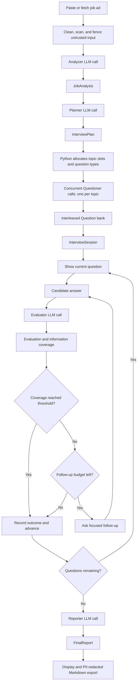

# Architecture

`interview_AI` is a staged LLM pipeline controlled by a deterministic Python state machine.
The analyzer, planner, questioner, evaluator, and reporter are five task-specific uses of the
same model client. Each has its own prompt and typed output; Python passes those outputs
forward and owns the rules that must stay predictable.

## What has been built

The finished application turns one job advertisement into a complete practice-interview
experience:

1. accept pasted text or fetch a public job URL;
2. clean and scan the advertisement as untrusted input;
3. extract the role, seniority, responsibilities, technologies, and evidence-backed
   requirements;
4. convert those requirements into a weighted technical and behavioral syllabus;
5. generate a balanced question bank whose content and difficulty match the role;
6. run an adaptive interview that privately scores answers and follows up on missing
   information;
7. measure which advertised requirements the candidate demonstrated;
8. create a downloadable report containing scores, strengths, gaps, and a study plan.

The implementation also includes five comparable prompting strategies, structured-output
validation, retry and usage accounting, security controls, 209 offline tests, and a paid
five-arm evaluation with an independent local judge.

## Runtime flow

The runtime has three phases: interview preparation, the live adaptive loop, and reporting.



The preparation chain is coordinated by `prepare_interview()` in
[`pipeline/__init__.py`](../src/interview_ai/pipeline/__init__.py). The live loop is held by
`InterviewSession` in [`domain/interview.py`](../src/interview_ai/domain/interview.py).

## Five typed AI stages

Every model response has a Pydantic contract. Malformed JSON or invalid values are corrected
before the object can reach the UI or state machine.

| Stage | Pipeline implementation | Main input | Validated output | Purpose |
|---|---|---|---|---|
| Analyzer | [`analyze_job.py`](../src/interview_ai/pipeline/analyze_job.py) | Untrusted job-ad text | `JobAnalysis` | Detect role/seniority and extract quoted requirements |
| Planner | [`build_plan.py`](../src/interview_ai/pipeline/build_plan.py) | `JobAnalysis`, difficulty | `InterviewPlan` | Convert requirements into weighted interview topics |
| Questioner | [`generate_questions.py`](../src/interview_ai/pipeline/generate_questions.py) | Analysis, topic, assigned slots | `QuestionBatch` | Write grounded questions and private rubrics |
| Evaluator | [`score_answer.py`](../src/interview_ai/pipeline/score_answer.py) | Question, rubric, current exchange | `Evaluation` | Score an answer and propose a focused follow-up |
| Reporter | [`generate_report.py`](../src/interview_ai/pipeline/generate_report.py) | Transcript, scores, measured outcomes | `FinalReport` | Produce the final recommendation and study plan |

The contracts live under [`domain/`](../src/interview_ai/domain/):

- `JobAnalysis` contains role, seniority, requirements, evidence, technologies, and emphasis.
- `InterviewPlan` contains 3-8 topics and validates that integer weights total exactly 100.
- `Question` contains its topic, assigned type, requirement targets, text, and private rubric.
- `Evaluation` contains five 1-5 scores, a verdict, 0-1 information coverage, gaps, and a
  possible follow-up.
- `FinalReport` contains a 0-100 overall score, recommendation, per-topic scores, strengths,
  weaknesses, unmet requirements, and study actions.

## What the model decides and what Python enforces

The model handles semantic judgment and natural language. Python owns invariants and global
coordination.

| Concern | Model responsibility | Deterministic Python responsibility |
|---|---|---|
| Job understanding | Interpret duties, seniority, and requirement importance | Reject empty/non-job input and validate the response shape |
| Interview syllabus | Propose grounded topics, weights, and rationales | Enforce topic limits, a 100% total, and genuine behavioral coverage |
| Question writing | Write natural questions and answer rubrics | Allocate counts, reserve behavioral coverage, assign types, and interleave topics |
| Answer review | Judge accuracy, depth, evidence, communication, relevance, and coverage | Decide whether coverage is sufficient and whether a follow-up may be used |
| Final debrief | Explain performance and recommend study actions | Supply measured unmet targets and redact the exported transcript |
| Reliability | Produce structured JSON | Validate, retry, limit concurrency/calls, and record usage |

This boundary exists because prompt instructions alone were not reliable enough. Earlier
experiments showed repeated question types, technical topics mislabeled as soft skills, and
an evaluator that almost never chose to advance. Those global decisions are now explicit
code and therefore testable.

## Adaptive interview state machine

`InterviewSession` stores the active question, previous turns, pending follow-up, private
evaluations, and completed question outcomes. The UI asks the session only for the prompt to
display and submits the next answer back to it.

Difficulty defines a fixed default coverage threshold:

| Difficulty | Default threshold | Meaning |
|---|---:|---|
| Easy | 0.50 | A partially complete answer can advance |
| Medium | 0.70 | Most rubric substance must be demonstrated |
| Hard | 0.85 | The answer must be nearly complete |

The threshold does not increase after a follow-up. Coverage is recalculated over the whole
exchange, while the threshold stays fixed:

```text
first answer coverage 0.40 < threshold 0.70  -> ask a follow-up
whole exchange coverage 0.75 >= 0.70         -> advance
```

If coverage remains below the threshold after the configured follow-up budget is exhausted,
the question closes as unmet. `QuestionOutcome` records its targets, final coverage,
threshold, answer count, and missing points. The reporter receives these measurements rather
than trying to reconstruct them from prose later.

Scores remain private during the interview. Each answer receives five 1-5 dimensions:
correctness, depth, practical experience, communication, and relevance. Information coverage
is a separate 0-1 flow-control measurement.

## Question allocation and concurrency

`InterviewPlan.question_allocation()` uses largest-remainder apportionment to convert topic
weights into an exact number of questions. The generator then:

1. guarantees a real behavioral topic and at least one behavioral slot for interviews of
   sufficient length;
2. assigns question types across the complete interview rather than inside isolated calls;
3. starts one asynchronous model call per topic under a shared concurrency semaphore;
4. tolerates an individual topic-call failure if other topics produced usable questions;
5. round-robins the topic buckets so similar questions do not appear consecutively.

This fan-out makes preparation approach the latency of the slowest topic call rather than
the sum of every topic call.

## Prompt architecture

Prompt text is stored under [`src/interview_ai/prompts/`](../src/interview_ai/prompts/) and
loaded by [`prompts/__init__.py`](../src/interview_ai/prompts/__init__.py). Each product stage
has:

```text
system.txt       shared task rules
user.txt         runtime input template
guide.txt        guided strategy procedure
critique.txt     self-critique draft-audit-revise checklist
examples/        one-shot and few-shot examples
```

The same five alternative treatments are available for every product stage:

| Strategy | Prompt composition |
|---|---|
| `zero_shot` | Shared rules only |
| `one_shot` | Shared rules plus one worked example |
| `few_shot` | Shared rules plus three worked examples |
| `guided` | Shared rules plus a stage-specific procedure |
| `self_critique` | Shared rules plus a stage-specific draft-audit-revise checklist |

The base rules, user input, model, and output schema stay fixed. Only the appended technique
block changes, creating 5 stages × 5 techniques = 25 comparable prompt variants. Integration
tests verify that every strategy begins with byte-identical base rules.

Friendly, neutral, and strict personas change only the tone of candidate-facing questioner
and evaluator prompts. They do not change the scoring schema or interview state machine.

## LLM and structured-output layer

[`llm/client.py`](../src/interview_ai/llm/client.py) wraps an OpenAI-compatible asynchronous
client pointed at OpenRouter by default. The layer provides:

- `instructor` JSON-mode schema injection, parsing, and validation correction;
- Pydantic response validation before objects enter the application;
- `tenacity` exponential backoff for transient transport, timeout, status, and rate-limit
  failures;
- a semaphore limiting simultaneous model calls;
- stage-specific output-token limits;
- token, cost, median-latency, and maximum-latency accounting;
- an optional alternate OpenAI-compatible endpoint for the local evaluation judge.

Pricing is fetched from OpenRouter's public model list and cached. A pricing lookup failure
does not stop an interview; usage remains available even if estimated cost cannot be shown.

## Security boundaries

Job ads and candidate answers are untrusted input. Security is layered around the LLM rather
than delegated to it alone.

```text
User text or fetched HTML
        -> normalize and strip invisible/control characters
        -> enforce character/byte/time limits
        -> detect prompt-injection patterns and show risk in the UI
        -> neutralize forged UNTRUSTED fence markers
        -> fence the content as data inside the model prompt
        -> validate structured model output
        -> block apparent system-prompt leakage
        -> redact PII and credentials before export/logging
```

URL fetching in [`utils/jobsource.py`](../src/interview_ai/utils/jobsource.py) permits only
public HTTP(S) targets, resolves and rejects private/internal addresses, revalidates the final
redirect target, limits response size, and applies a timeout. A per-session `RateLimiter`
caps model calls so one Streamlit tab cannot consume the API key indefinitely.

## Configuration lifecycle

[`config.py`](../src/interview_ai/config.py) reads configuration with this precedence:

```text
environment variable > config/settings.toml > built-in default
```

Secrets live only in `.env`. Model, interview, coverage, concurrency, retry, token, and input
limits live in [`config/settings.toml`](../config/settings.toml). The Streamlit sidebar uses
`dataclasses.replace()` to create an immutable per-session `Settings` value, so one user's
choices do not mutate the process-wide defaults. Settings lock after an interview starts.

## Application and folder boundaries

### `app.py` and `ui/`

The root [`app.py`](../app.py) is a small Streamlit launcher. The real setup, interview, and
report screens live in [`ui/app.py`](../src/interview_ai/ui/app.py). UI code renders state and
dispatches pipeline work; it does not contain prompt or scoring rules.

### `pipeline/`

Contains one module per AI stage plus the preparation orchestrator. Pipeline functions accept
domain objects and return validated domain objects.

### `domain/`

Contains the Pydantic contracts and the model-independent `InterviewSession` state machine.
This separation allows interview progression and arithmetic to be tested without Streamlit
or real API calls.

### `llm/`

Contains transport, structured-output validation, retries, pricing, and usage accounting.

### `prompts/`

Contains versioned prompt text, strategies, personas, examples, and shared anti-injection /
anti-invention rules.

### `utils/`

Contains input hygiene, injection detection, PII/credential redaction, call limiting, and
safe job-ad URL extraction.

## Evaluation architecture

The optional [`evaluation/`](../evaluation/) package imports the application, but the runtime
application never imports evaluation code. This one-way dependency keeps pandas, SciPy,
scikit-learn, YAML, fixtures, and judge logic outside the production dependency path.

The benchmark runs the same fixtures through each selected prompt strategy and measures 29
thresholded quality gates plus diagnostic statistics. It can use a separate local Gemma model
through Ollama for independent answer and question judgments. Primary-model and judge results
are kept separate so the model never sees the score it is being compared against.

```text
Labeled ads / answers / attacks
              -> five application strategy arms
              -> deterministic metrics and thresholds
              -> optional independent Gemma judgments
              -> Markdown + JSON aggregate report
              -> append-only JSONL raw provenance
```

See [`evaluation.md`](evaluation.md) for the complete threshold definitions and the latest
five-arm findings.

## What the experiments found

Architecture decisions were driven by measured failure modes rather than prompt preference
alone.

| Finding | Observed behavior | Architectural response |
|---|---|---|
| Topic-isolated generation could not balance the whole interview | Earlier question-type diversity was only 0.40-0.49 | Python assigns types globally before concurrent generation |
| The evaluator was a poor flow controller | In an earlier 48-case sample it never chose `advance` | Python advances from numeric coverage and a fixed threshold |
| Keyword-only soft-skills detection was misleading | “Team-based CI/CD ownership” was counted as behavioral | Python rejects technical markers and inserts a genuine people-focused topic |
| Model output can be structurally wrong | An older one-shot run produced plan weights totaling 102 | Pydantic validation and correction happen at every model boundary |
| Prompt complexity does not guarantee better quality | Self-critique ranked fourth in the latest five-arm run | All strategies remain selectable and are compared instead of assuming a winner |

The latest full run used `openai/gpt-5-nano`, all ad/answer/security fixtures, and a local
`gemma4:e4b` second opinion:

| Strategy | Composite | Thresholds | Main finding |
|---|---:|---:|---|
| Few-shot | **0.9697** | **29/29** | Only arm to pass every quality gate |
| Guided | 0.9545 | 28/29 | Strong overall, but follow-up style missed its gate |
| One-shot | 0.9474 | 28/29 | Best requirement/question grounding and fastest median call |
| Self-critique | 0.9362 | 28/29 | Strong schemas/scoring, but weak independent verdict agreement |
| Zero-shot | 0.9230 | 27/29 | Cheapest, but missed two independent-judge gates |

Across all five strategies, schema validity, requirement evidence grounding, role accuracy,
prompt-leak resistance, and both injection-resistance checks scored 1.0. The result supports
the layered security and typed-contract design, but it is still a four-ad, six-answer,
single-repeat development benchmark. The change from August—where guided passed every gate—to
September—where few-shot won—also shows why the project retains raw outputs and avoids
treating a small difference from one run as permanent.

## Storage and artifacts

Live interview data is held in Streamlit session state and is cleared when the session is
reset or expires.

Evaluation data is the exception: benchmark reports are written to `artifacts/`. Ordinary
generated runs remain ignored and disposable, while the latest five-arm Markdown, JSON, and
raw JSONL evidence bundle is explicitly retained so documentation links work in a submitted
repository. Raw outputs are appended as calls finish, so an interrupted benchmark preserves
everything completed before the failure.
